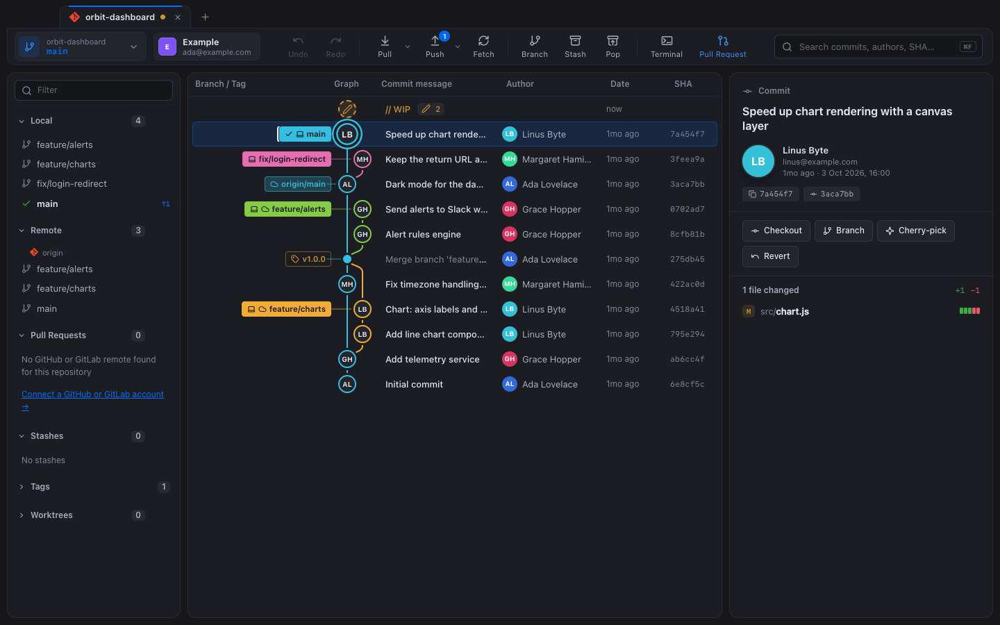
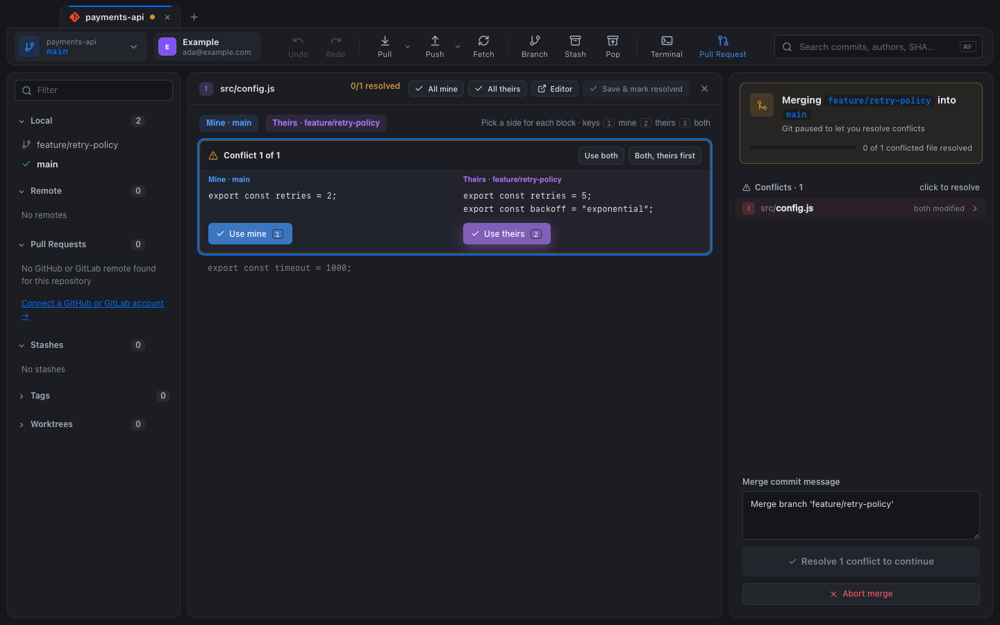

<div align="center">

# Nebula

**A free, open-source alternative to GitKraken.**
A fast, good-looking Git client for macOS: commit graph, painless merge conflicts, pull requests, issues, multiple accounts and an integrated terminal. No subscription, no sign-up, no telemetry.

[](https://github.com/ryolay/nebula/actions/workflows/ci.yml)
[](eslint.config.js)
[](https://github.com/ryolay/nebula/releases)
[](LICENSE)
[](https://github.com/ryolay/nebula)


[](https://www.electronjs.org)
[](CONTRIBUTING.md)



</div>

## Why Nebula?

GitKraken is a great tool, but several of its key features, such as private repositories and multiple accounts, sit behind a paid plan. Nebula is a free alternative under the MIT license. It covers everyday Git work and puts extra effort into the areas where other clients feel clumsy:

- **Merge conflicts are dead simple.** A conflict is a state, not an error: pick *mine*, *theirs* or *both* per block (keys `1` `2` `3`), and Nebula opens the next file for you.
- **Multiple GitHub and GitLab accounts, done right.** Choose the account per repository. Nebula injects that account's token only into its own commands, so your global `gh` login never changes.
- **The right commit identity, every time.** Set identities per repository, per folder or globally. A banner warns you before you commit with the wrong email.
- **Nebula runs your real Git.** It calls the `git` and `gh` binaries you already have, with no bundled reimplementation, so whatever Nebula does you can reproduce in a terminal.

## Features

### Graph and history
- Commit graph with colored lanes, merge curves and author avatars (GitHub or Gravatar, with initials as a fallback)
- Branch, remote and tag labels; a WIP row for uncommitted changes
- Search by message, author or SHA (`⌘F`)
- File history (follows renames), blame, and comparison of any two commits or branches

### Everyday Git
- Stage, unstage and discard changes by file, **by hunk or by line**; commit and amend
- Branches: create, check out (double-click), merge, rebase, rename, delete
- **Drag a branch onto another** to merge, rebase, fast-forward or open a pull request
- Commits: cherry-pick, revert, reset (soft, mixed or hard), branch or tag here
- Stashes: stash, apply, pop, drop
- Fetch, pull (fast-forward, merge or rebase) and push (with force-with-lease), with ahead/behind badges and a progress HUD
- **Undo and redo** (`⌘Z` / `⇧⌘Z`) for commits, merges, pulls, rebases, cherry-picks, resets, checkouts, branches and stashes

### Power tools
- **Interactive rebase**: pick, reword, squash and drop; drag to reorder
- Continue, skip or abort for merge, rebase, cherry-pick and revert; no editor ever pops up
- Remotes, worktrees (each opens in its own tab), submodules and Git LFS

### GitHub and GitLab
- **Pull requests** connected to your account. Pick the exact base and compare branches, with a live preview of the commits, the files and whether the branches merge cleanly. Set reviewers (people or teams), assignees, labels and a milestone, or open it as a draft. The branch is published for you if needed.
- PR list, details, checkout and merge. GitLab merge requests work too.
- **Issues**: list, read (Markdown), comment, assign, close or reopen, create, and **start a branch from an issue**
- Multiple GitHub accounts (including Enterprise) through `gh`, and GitLab accounts through tokens stored in the macOS Keychain
- **One-click SSH** for each account: Nebula generates the key, adds a host alias to `~/.ssh/config`, uploads the public key and checks the connection



### Workspace
- One tab per repository; the **+** button opens a recent repository, clones from your accounts or a URL, or opens a folder
- **Integrated terminal** (`⌃\``): your real login shell running in the repository, with Nerd Font icons
- Resizable, collapsible side panels
- Light and dark themes that follow macOS, a choice of accent colors, and WCAG AA text contrast

## Install

Nebula is not notarized yet, so build it from source. This takes about two minutes.

**Requirements:** macOS 12 or later, [Node.js](https://nodejs.org) 20 or later, Git, the Xcode Command Line Tools (`xcode-select --install`), and optionally the [GitHub CLI](https://cli.github.com) for GitHub features.

```bash
git clone https://github.com/ryolay/nebula.git
cd nebula
npm install          # also builds the native terminal module for Electron
npm start            # run in development
npm run dist         # build dist/Nebula-darwin-<arch>/Nebula.app
```

Move `Nebula.app` to `/Applications`. Because the app is not signed, open it the first time with right-click › **Open**.

You can open a repository directly with `npm start -- ~/code/my-repo`.

## Development

| Command | What it does |
| --- | --- |
| `npm start` | Run the app |
| `npm test` | Every test: unit tests and end-to-end tests against the real app |
| `npm run test:unit` | Git backend, graph layout, identities, SSH, PRs, issues |
| `npm run test:e2e` | Launch Electron on throwaway repositories and drive the UI |
| `npm run lint` | ESLint (the engine Codacy uses) plus a duplication check |
| `npm run screenshots` | Regenerate the images in `docs/` from a demo repository |
| `npm run dist` | Package the macOS app |

The tests never touch your own configuration. They run on throwaway repositories (a bare `origin` plus clones) with an isolated Git config, and use fake `gh` and `ssh` binaries.

### Architecture

```
src/
  main.js        Electron main process: window, menus, IPC
  preload.js     the narrow bridge the UI is allowed to call
  git.js         every Git operation (argument arrays only, no shell)
  accounts.js    GitHub (gh) and GitLab accounts, per-repo token routing
  identity.js    commit identities, folder rules, wrong-identity detection
  ssh.js         one-click SSH keys and ~/.ssh/config management
  gitlab.js      GitLab REST API
  terminal.js    node-pty sessions
  renderer/      the UI: plain HTML, CSS and JavaScript, no framework
```

The stack is Electron, node-pty and xterm.js. The UI has no framework and no build step.

## Contributing

Issues and pull requests are welcome. Read [CONTRIBUTING.md](CONTRIBUTING.md) first, and report security issues privately as described in [SECURITY.md](SECURITY.md).

## License

[MIT](LICENSE) © 2026 Christian Da Silva Perez

Nebula is an independent project. It is not affiliated with or endorsed by GitKraken (Axosoft), GitHub or GitLab. All trademarks belong to their respective owners. The GitHub and GitLab logos appear only to identify those services. The bundled Symbols Nerd Font is MIT-licensed (see `src/renderer/fonts/`).
